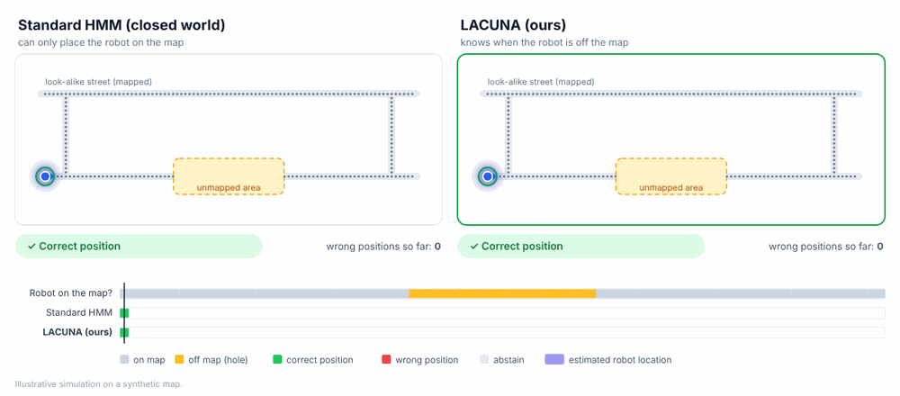
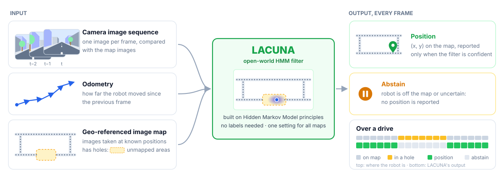
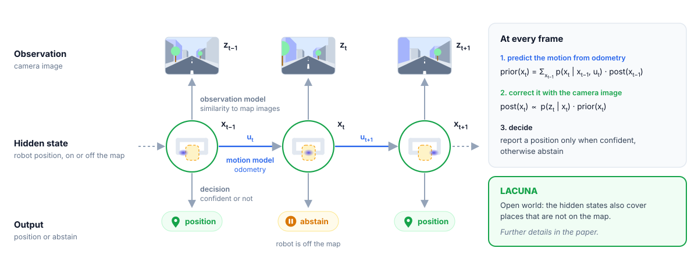
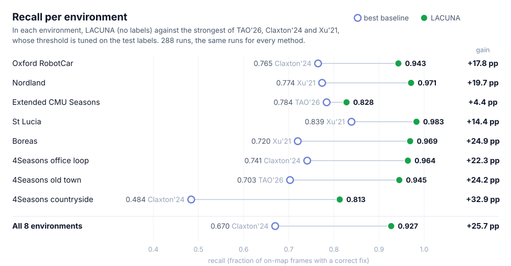

<div align="center">

# LACUNA

**L**ocalization **A**ware of **C**overage and **UN**mapped **A**reas

### Open-World Sequential Visual Localization on Maps with Holes

[**Nhat Long Nguyen**](https://github.com/nhatlong113)

[](#citation)
[](#citation)

</div>

> [!NOTE]
> The paper and code will be released soon.

<p align="center"></p>
<p align="center"><sub>Illustrative simulation on a synthetic map. When the robot drives through an unmapped area, a standard HMM matches
it to a similar-looking street and reports wrong positions. LACUNA recognizes that the robot is off the map, reports no position, and
resumes shortly after the robot returns to the map.</sub></p>

## Problem

A robot can localize itself by comparing its camera images with a map made of images taken at known positions. A Hidden Markov Model
(HMM) combines these comparisons over time, often together with odometry. Real maps, however, are incomplete: some streets were never mapped,
and construction or seasonal occlusion creates further gaps. A standard HMM only has states for mapped places. When the robot enters an
unmapped area, the HMM must still place it somewhere on the map, often at a similar-looking place, and can report a confident but wrong
position.

**Goal:** report the correct position whenever the robot is on the map, and report no position while it is off the map, without any
labeled data at deployment.

## Input and Output

<p align="center"></p>

At each frame, LACUNA receives the camera image, the odometry since the previous frame and the image map. It outputs either a position on
the map or no position (abstain).

## Method: an Open-World HMM

<p align="center"></p>

LACUNA keeps the structure of an HMM:

- **Hidden state:** where the robot is. Unlike in a standard HMM, the states also include places outside the map, so the model can
  represent a robot that is off the map.
- **Motion model:** odometry predicts how the robot moves from one frame to the next.
- **Observation model:** the camera image is compared with every map image, which indicates how well each state matches what the robot
  sees.
- **Filtering:** prediction and correction repeat at every frame, so evidence builds up over the image sequence instead of relying on a
  single image. LACUNA reports a position only when it is confident and abstains otherwise.

How LACUNA stays reliable without labeled data will be described in the paper.

## Key Properties

- **Knows where the map ends.** Reliably abstains in unmapped areas, without a separate off-map detector trained on labeled data.
- **No labels needed.** Uses no labeled data at deployment and one setting for all datasets and image descriptors.
- **Fast.** About 6 ms per frame on a single NVIDIA L4 GPU.

## Results

We test LACUNA on 8 environments from 6 public datasets, with 6 different image descriptors. In every test, 30% of the map is removed at
random to create unmapped areas. All test decisions were fixed in advance, and none of the test hole layouts were used during development.

Over **432 test runs**, LACUNA reports the correct position for **93%** of on-map frames on average. In **99.3%** of runs, it reports a
position in no more than 5% of the stretches where the robot is off the map (our false-positive target).

Comparison with recent methods on 288 of these runs (the same runs for every method):

| Method | Labels used | Recall ↑ | Navigation error (m) ↓ |
|:---|:---:|:---:|:---:|
| Xu *et al.*, RA-L 2021 † | test labels | 0.651 | 44.5 |
| Claxton *et al.*, RA-L 2024 † | test labels | 0.670 | 28.1 |
| TAO, arXiv 2026 † | test labels | 0.651 | 37.1 |
| Closed-world baseline | none | 0.802 | 15.0 |
| **LACUNA** | **none** | **0.927** | **13.3** |

<sub>**Recall:** share of on-map frames with a correct reported position.</sub><br>
<sub>**Navigation error:** mean position error of a Kalman filter that uses the reported positions.</sub><br>
<sub>**†** Re-implemented from the original paper. The decision threshold is tuned on the ground truth of each test run, which gives the
method the highest recall its scores allow under the same 5% false-positive target.</sub>

<p align="center"></p>

## Datasets and Related Work

| Dataset | Reference | Links |
|:---|:---|:---|
| Oxford RobotCar | Maddern *et al.*, IJRR 2017 | [project](https://robotcar-dataset.robots.ox.ac.uk/) · [paper](https://doi.org/10.1177/0278364916679498) |
| Nordland | NRK, 2013 | [data](https://nrkbeta.no/2013/01/15/nordlandsbanen-minute-by-minute-season-by-season/) |
| Extended CMU Seasons | Sattler *et al.*, CVPR 2018 | [project](https://www.visuallocalization.net/datasets/) · [paper](https://arxiv.org/abs/1707.09092) |
| St Lucia | Glover *et al.*, ICRA 2010 | [paper](https://doi.org/10.1109/ROBOT.2010.5509547) |
| Boreas | Burnett *et al.*, IJRR 2023 | [project](https://www.boreas.utias.utoronto.ca/) · [paper](https://arxiv.org/abs/2203.10168) |
| 4Seasons | Wenzel *et al.*, GCPR 2020 | [project](https://www.4seasons-dataset.com/) · [paper](https://arxiv.org/abs/2009.06364) |
| NCLT | Carlevaris-Bianco *et al.*, IJRR 2016 | [project](http://robots.engin.umich.edu/nclt/) · [paper](https://doi.org/10.1177/0278364915614638) |

- **Image descriptors:** [NetVLAD](https://arxiv.org/abs/1511.07247) · [CosPlace](https://arxiv.org/abs/2204.02287) ·
  [MixVPR](https://arxiv.org/abs/2303.02190) · [SALAD](https://arxiv.org/abs/2311.15937) · [MegaLoc](https://arxiv.org/abs/2502.17237) ·
  [DINOv2](https://arxiv.org/abs/2304.07193)
- **Sequence-based place recognition:** [SeqSLAM](https://doi.org/10.1109/ICRA.2012.6224623) (ICRA 2012) ·
  [HMM sequence matching](https://doi.org/10.1109/IROS.2014.6943207) (IROS 2014) ·
  [Doan *et al.*](https://arxiv.org/abs/1908.00178) (ICCV 2019) · [VPR survey](https://doi.org/10.1109/TRO.2015.2496823) (T-RO 2016)
- **Off-map detection and integrity monitoring:** [Xu *et al.*](https://arxiv.org/abs/2107.07707) (RA-L 2021) ·
  [Claxton *et al.*](https://arxiv.org/abs/2407.08162) (RA-L 2024) · [Lu & Tanaka](https://arxiv.org/abs/2607.04745v1) (arXiv 2026)

## Citation

```bibtex
@misc{nguyen2026lacuna,
  title  = {{LACUNA}: Open-World Sequential Visual Localization on Maps with Holes},
  author = {Nhat Long Nguyen},
  year   = {2026},
  note   = {Paper and code coming soon}
}
```
